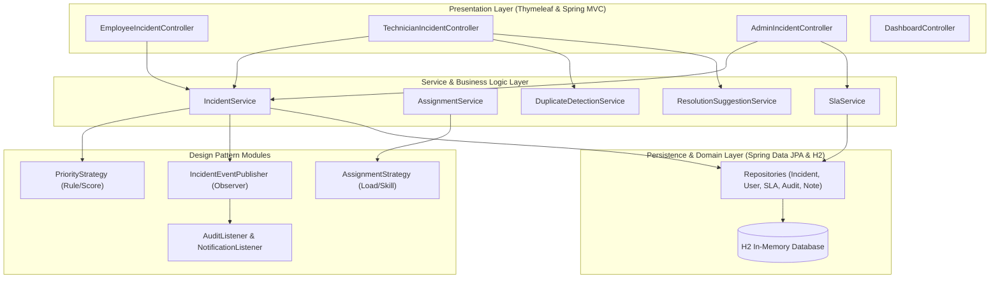
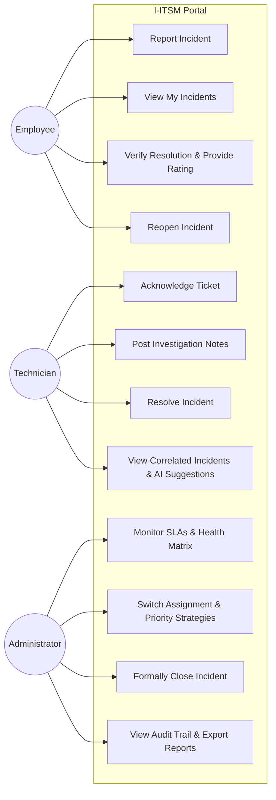
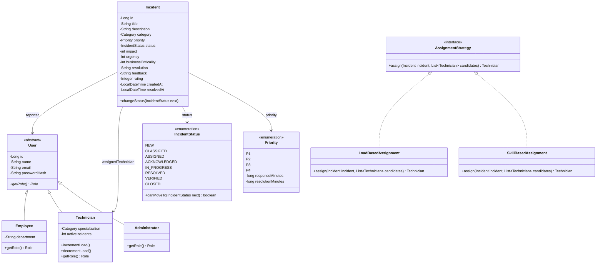
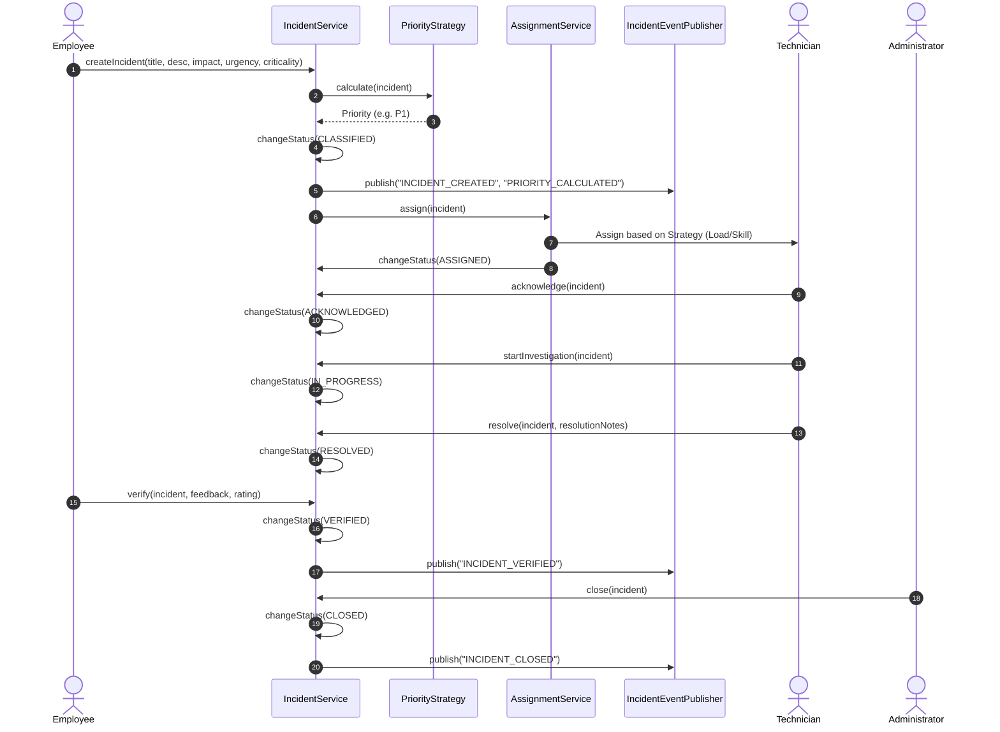

# Project Report: Intelligent IT Service Management (I-ITSM) System

**Course:** Object-Oriented Programming (CS F213 / OOP)  
**Institution:** BITS Pilani  
**Repository:** [https://github.com/annibold/OOPS-Project](https://github.com/annibold/OOPS-Project)  
**Technology Stack:** Java 21, Spring Boot 4.1.2, Spring Security, Spring Data JPA, H2 In-Memory Database, Thymeleaf, JUnit 5, Mockito, Maven  

### Project Team Members
| S. No. | Student Name | BITS ID Number | Project Responsibilities |
|:---:|:---|:---:|:---|
| 1 | **Aniruddh Pandey** | `2027A7PS0065H` | Architecture, Domain Modeling, Strategy Patterns & Intelligent Heuristics |
| 2 | **Kushagr Kakkar** | `2025A7PS0071H` | State Machine, Spring Security, Lifecycle Controllers & Role-Based UI |
| 3 | **Ishaan Singhal** | `2025A7PS0171H` | SLA Monitoring Engine, Background Scheduler & Notification Listeners |
| 4 | **Mitansh Gupta** | `2025A7PS0159H` | Verification & Rating System, Audit Trail & Unit Testing Suite |  

---

## 1. Problem Analysis & Domain Scope

### 1.1 Problem Statement
Modern enterprise IT infrastructures handle hundreds of incidents daily, ranging from high-urgency database outages to routine software license requests. Traditional ticketing systems suffer from three primary bottlenecks:
1. **Manual Triage & Delayed Response:** Tickets sit unassigned until a service desk coordinator manually reviews them.
2. **SLA Violations:** Without automated background tracking, Service Level Agreement (SLA) deadlines are breached without early warning.
3. **Redundant Resolution Efforts:** Technicians repeatedly resolve known recurring issues from scratch because historical solutions and duplicate tickets are not surfaced intelligently.

### 1.2 System Objectives
The **Intelligent IT Service Management (I-ITSM)** system automates the incident lifecycle using object-oriented design patterns and heuristic intelligence:
- **State-Driven Incident Lifecycle:** Strict finite state machine governing transitions from `NEW` to `CLOSED`.
- **Dynamic Strategy-Based Triage:** Automated priority scoring (P1–P4) and intelligent technician assignment based on current workload and specialized domain skillsets.
- **Asynchronous Observer Pattern:** Decoupled event publishing for audit logging and multi-channel notifications (simulated email and in-app alerts).
- **Proactive SLA Monitoring:** Background scheduling engine evaluating acknowledgment and resolution deadlines, flagging incidents as `ON_TRACK`, `AT_RISK`, or `VIOLATED`.
- **Intelligent Assistance:** Token-based Jaccard similarity for duplicate detection and heuristic recommendation of historical solutions.
- **End-to-End Governance:** Employee verification, rating/feedback collection, and administrative ticket closure.

---

## 2. System Architecture

The application adopts a **Layered Model-View-Controller (MVC)** architectural pattern with clean separation of concerns and dependency injection:

---

## 3. UML Diagrams

### 3.1 Use Case Diagram

### 3.2 Domain Class Diagram

### 3.3 Sequence Diagram: Incident Lifecycle & Resolution Flow

---

## 4. Design Patterns Implementation

| Pattern | Implementation Class | Role & Architectural Benefit |
|---|---|---|
| **Strategy Pattern** | `AssignmentStrategy`, `LoadBasedAssignment`, `SkillBasedAssignment` | Decouples technician allocation algorithms. The system switches between least-loaded and skill-matched assignment at runtime without altering core incident logic. |
| **Strategy Pattern** | `PriorityStrategy`, `RuleBasedPriorityStrategy`, `ScoreBasedPriorityStrategy` | Calculates P1–P4 priorities dynamically from business criticality, impact, and urgency matrices. |
| **Observer Pattern** | `IncidentEventPublisher`, `AuditListener`, `NotificationListener` | Decouples core incident modifications from auditing and notification dispatching. Observers react asynchronously to state transitions. |
| **State Pattern** | `IncidentStatus`, `Incident.changeStatus()` | Encapsulates valid transitions directly within the enum via `canMoveTo()`, rejecting illegal state bypasses. |
| **Template Method / Inheritance** | `User` &rarr; `Employee`, `Technician`, `Administrator` | Defines common user identity, authentication, and role authorization contracts while allowing specialized subclasses to maintain domain data (e.g., active loads, specializations). |

---

## 5. Mapping of Object-Oriented Principles

1. **Encapsulation:**
   - Private fields across all entity models (`Incident`, `User`, `SlaEvent`).
   - Mutations to status are strictly guarded through `Incident.changeStatus()`, which validates lifecycle rules before modifying state.
2. **Inheritance:**
   - JPA Single-Table Inheritance (`@Inheritance(strategy = InheritanceType.SINGLE_TABLE)`) with discriminator values `EMPLOYEE`, `TECHNICIAN`, `ADMIN` extending abstract base class `User`.
3. **Polymorphism:**
   - Strategy invocation: `AssignmentService` depends on interface `AssignmentStrategy`. Swapping `LoadBasedAssignment` with `SkillBasedAssignment` occurs transparently via Spring configuration.
4. **Abstraction:**
   - Repositories abstract SQL operations (`IncidentRepository`, `TechnicianRepository`).
   - Event listeners abstract multi-channel notifications (`NotificationChannel`, `EmailSimulatedChannel`, `InAppNotificationChannel`).

---

## 6. Unit Testing Documentation

All 19 unit tests execute via JUnit 5 and Mockito, verifying core domain logic, state machines, SLA computations, and intelligent heuristic detection:

| Test ID | Test Class | Test Method | Type | Validated Outcome |
|---|---|---|---|---|
| TC-01 | `DemoApplicationTests` | `contextLoads()` | Integration | Spring Boot application context bootstraps cleanly. |
| TC-02 | `IncidentTest` | `newIncident_defaultsToNewStatus` | Normal | Incident initializes in `NEW` state with valid timestamps. |
| TC-03 | `IncidentTest` | `validStateTransition_succeeds` | Normal | `NEW` &rarr; `CLASSIFIED` &rarr; `ASSIGNED` transition succeeds. |
| TC-04 | `IncidentTest` | `invalidStateTransition_throws` | Boundary | Invalid jump `NEW` &rarr; `RESOLVED` throws `InvalidStateTransitionException`. |
| TC-05 | `IncidentTest` | `resolve_setsResolvedAt` | Normal | Status change to `RESOLVED` populates `resolvedAt` timestamp. |
| TC-06 | `AssignmentStrategyTest` | `loadBased_picksLeastBusyTechnician` | Business Rule | Picks technician with minimum active tickets. |
| TC-07 | `AssignmentStrategyTest` | `loadBased_throwsWhenNoTechnicians` | Boundary | Throws `TechnicianUnavailableException` when list is empty. |
| TC-08 | `AssignmentStrategyTest` | `skillBased_picksMatchingSpecialization` | Business Rule | Assigns technician whose specialization matches incident category. |
| TC-09 | `AssignmentStrategyTest` | `skillBased_fallsBackToLeastBusy` | Boundary | Falls back to least-loaded tech when no specialization matches. |
| TC-10 | `SlaServiceTest` | `p1Incident_onTrackInitially` | Normal | Newly created P1 incident reports `ON_TRACK`. |
| TC-11 | `SlaServiceTest` | `p1Incident_atRiskBeforeResolutionDeadline` | Boundary | Incident nearing resolution deadline flags `AT_RISK`. |
| TC-12 | `SlaServiceTest` | `p1Incident_violatedWhenDeadlinePasses` | Business Rule | Breached resolution target correctly flags `VIOLATED`. |
| TC-13 | `IncidentServiceTest` | `createIncident_calculatesPriorityAndClassifies` | Normal | Creates incident, computes P2, and publishes event. |
| TC-14 | `IncidentServiceTest` | `createIncident_rejectsInvalidImpact` | Invalid | Out-of-bounds impact (4) throws `InvalidIncidentException`. |
| TC-15 | `IncidentServiceTest` | `verify_transitionsToVerified` | Normal | Verifies ticket and transitions status to `VERIFIED`. |
| TC-16 | `IncidentServiceTest` | `reopen_incrementsTechLoad` | Business Rule | Reopening rejected ticket increments technician active load. |
| TC-17 | `IncidentServiceTest` | `verify_recordsFeedbackAndRating` | Normal | Successfully captures rating (5/5) and feedback message. |
| TC-18 | `DuplicateDetectionServiceTest`| `detectsDuplicates_whenTextMatches` | Intelligent | Jaccard similarity detects correlated database connection issues. |
| TC-19 | `DuplicateDetectionServiceTest`| `ignoresUnrelatedIncidents` | Intelligent | Ignores unrelated printer and VPN issues correctly. |

---

## 7. Technology Evaluation & Rubric Criteria

1. **Why H2 Database for Development?**  
   Provides rapid in-memory schema generation and testing without external database dependencies, coupled with an embedded `/h2-console` viewer.
2. **Why Spring Security with BCrypt?**  
   Enforces enterprise-grade password salting/hashing and role-based access control (`ROLE_EMPLOYEE`, `ROLE_TECHNICIAN`, `ROLE_ADMIN`) restricting sensitive endpoints.
3. **How does the State Machine prevent corruption?**  
   `Incident.changeStatus()` guards every transition using enum adjacency matrices; invalid jumps are halted before any database write occurs.
4. **How are Intelligent Features implemented without external heavy dependencies?**  
   Tokenization, stop-word pruning, and Jaccard coefficient scoring deliver lightweight, fast, and explainable correlation matching and resolution suggestions in-memory.
